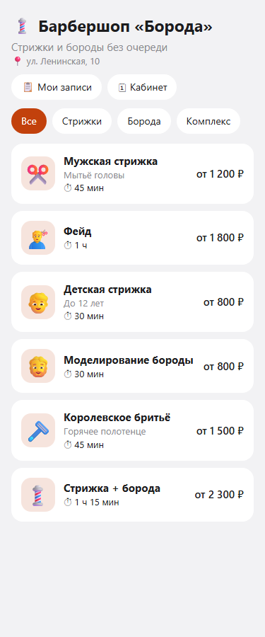
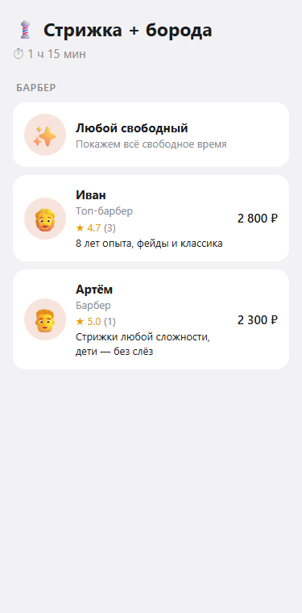
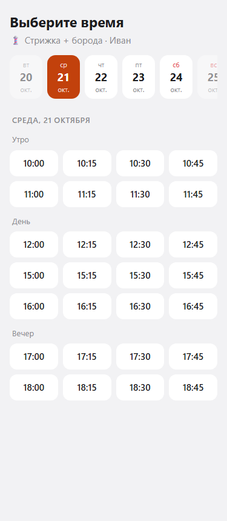
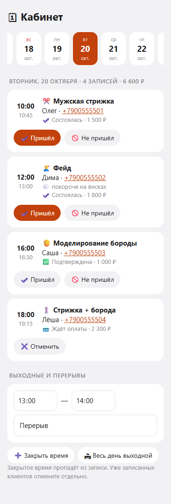

# Telegram Booking Bot — запись на услуги в Telegram

Бот + Mini App для барбершопа, салона красоты, репетитора, клиники — любого бизнеса «по записи».
Клиент выбирает услугу, мастера и время за 30 секунд; бот напоминает о визите, собирает отзывы и
возвращает клиентов. Бизнес — это папка с конфигом, код один.

[](https://github.com/egorstep147/telegram-booking-bot/actions/workflows/ci.yml)
 


| Услуги | Мастер | Время | Кабинет мастера |
|---|---|---|---|
|  |  |  |  |

## Готовые ниши

| Бизнес | Папка | Особенности |
|---|---|---|
| 💈 Барбершоп «Борода» | `niches/barbershop` | 3 мастера с разными ценами, перерывы, депозит 300 ₽ |
| 💅 Студия «Лаванда» | `niches/beauty` | 2 филиала, длинные услуги (наращивание 2,5 ч), без предоплаты |
| 🎓 Онлайн-школа «Пятёрка» | `niches/tutor` | Преподаватели вместо мастеров, полная предоплата, без листа ожидания |

## Возможности

**Клиенту (Mini App + бот)**
- услуга → мастер (рейтинг, цена у этого мастера) или «любой свободный» → день → время
- предоплата картой (депозит или полная), время держится N минут
- напоминания за сутки и за 2 часа с кнопками «Приду / Перенести / Отменить»
- перенос и отмена по правилам бизнеса («не позже чем за 3 часа»)
- лист ожидания: освободилось время — бот предложит его, запись в одно нажатие
- после визита — оценка и отзыв; через N недель — «пора на стрижку» с кнопкой записи

**Мастеру и владельцу**
- кабинет в Mini App: день с выручкой, телефоны клиентов, «пришёл / не пришёл», перерывы и выходные
- уведомления о новых записях, переносах и отменах
- синхронизация с Google Календарём мастера: записи появляются там, а личные дела закрывают время
- админка в боте: записи на сегодня, выручка, доля неявок, загрузка каждого мастера в %, рейтинг, рассылка

## Как устроено

**Двойная запись невозможна на уровне базы.** Даже если два клиента нажмут «Записаться» на 17:00 одновременно,
PostgreSQL пропустит только одного:

```sql
ALTER TABLE bookings ADD CONSTRAINT no_double_booking
  EXCLUDE USING gist (master_id WITH =, slot WITH &&)   -- slot = tstzrange(начало, конец + буфер)
  WHERE (status IN ('pending', 'confirmed'));
```
Проверка в коде («свободно ли по графику») нужна для удобства, а гарантию даёт база — между проверкой и записью
кто-то мог успеть. Тест `test_concurrent_requests_cannot_double_book` воспроизводит именно это.

**Свободное время** = рабочие интервалы мастера (с перерывами) − записи (с буфером на уборку) − выходные −
занятое в Google Календаре − «слишком скоро». Чистая функция `services/slots.py`, тестируется без базы.
Время считается в поясе бизнеса, переход на летнее время не сдвигает «каждый день в 10:00».

**Фоновые задачи** (`services/jobs.py`): снятие неоплаченных, напоминания по ступеням, завершение визитов,
«пора снова». Блокировка `FOR UPDATE SKIP LOCKED` — два процесса не отправят одно напоминание дважды.

```
src/booking/
├── services/   slots (алгоритм) · schedule (слоты из базы) · bookings (запись, перенос, отмена)
│               jobs (фоновые) · gcal (Google Календарь) · seed (загрузка ниши)
├── api/        эндпоинты мини-приложения, авторизация по подписи Telegram, кабинет мастера
├── bot/        клиент, напоминания, отзывы, лист ожидания, оплата, админка
├── db/models.py
└── app.py      FastAPI + бот + фоновый цикл в одном процессе
webapp/         Mini App: React 19 + TypeScript + Vite
niches/         бизнесы: config.yaml (правила) + catalog.yaml (услуги, мастера, графики)
```

## Быстрый старт

```sh
cp .env.example .env            # BOT_TOKEN, POSTGRES_PASSWORD, DATABASE_URL, ADMIN_IDS
docker compose up -d            # PostgreSQL и Redis
uv sync && uv run booking migrate && uv run booking seed
cd webapp && npm ci && npm run build && cd ..
uv run booking                  # бот + API на http://127.0.0.1:8085
```
Mini App нужен HTTPS: для разработки — `cloudflared tunnel --url http://localhost:8085`, адрес в `WEBAPP_URL`.
Целиком в Docker: `docker compose --profile app up -d --build`. Деплой на VPS — [deploy/DEPLOY.md](deploy/DEPLOY.md).

## Свой бизнес за час

1. Скопируйте `niches/barbershop` в `niches/mysalon`.
2. `config.yaml`: название, цвет, адрес, правила отмены, предоплата, напоминания.
3. `catalog.yaml`: услуги (длительность, цена, буфер), мастера (услуги, свои цены, график `mon-fri: ["10:00-14:00", "15:00-20:00"]`).
4. `uv run pytest tests/test_niches.py` — найдёт опечатки.
5. `NICHE=mysalon uv run booking seed`.

Чтобы мастер получал уведомления и открывал кабинет, укажите его `tg_id` (он узнает его у @userinfobot).
Для Google Календаря: создайте сервисный аккаунт, положите ключ в `GOOGLE_CREDENTIALS_FILE`, мастер делится
календарём с email аккаунта, в `catalog.yaml` — `gcal_id` (обычно его gmail).

## Разработка

```sh
uv run pytest                    # 20 тестов, нужен PostgreSQL (docker compose)
uv run ruff check src tests && uv run ruff format src tests
cd webapp && npm run dev         # фронтенд с горячей перезагрузкой, /api проксируется на 8085
```

## Лицензия
MIT
